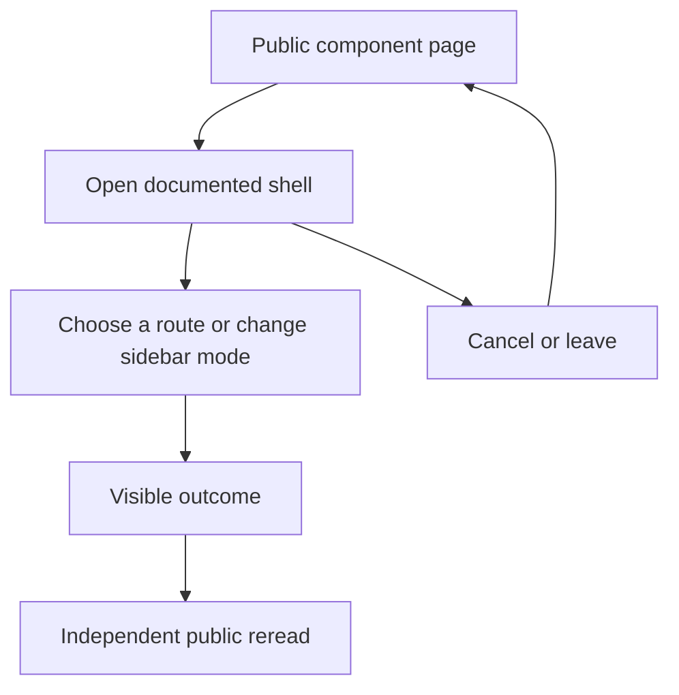

# Navigate to a workspace destination

## Actions

1. Enter the public page and identify its example and controls.
2. Choose a route or change sidebar mode.
3. Verify the result through a separate visible read, real destination or revisit.

## True end state

Linked component page loads with a matching heading; canceled navigation returns focus to its trigger.

## Abandonment

Close navigation without choosing, reopen through its trigger, then follow a real link.

## Independent reread

Read the visible destination heading and URL after link navigation; for transient
UI, inspect its absence/presence and the actual focused control, then reopen
through the original public entry. No durable server object is created.
