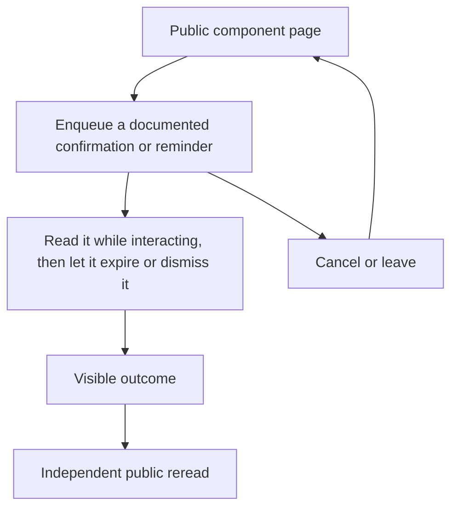

# Read and dismiss a notification

## Actions

1. Enter the public page and identify its example and controls.
2. Read it while interacting, then let it expire or dismiss it.
3. Verify the result through a separate visible read, real destination or revisit.

## True end state

Confirmation expires only after unpaused time; persistent reminder remains until Done and focus returns to an eligible opener.

## Abandonment

Pause reading by hover or focus, resume, then enqueue a fresh reminder after revisiting the page.

## Independent reread

Read the visible destination heading and URL after link navigation; for transient
UI, inspect its absence/presence and the actual focused control, then reopen
through the original public entry. No durable server object is created.
