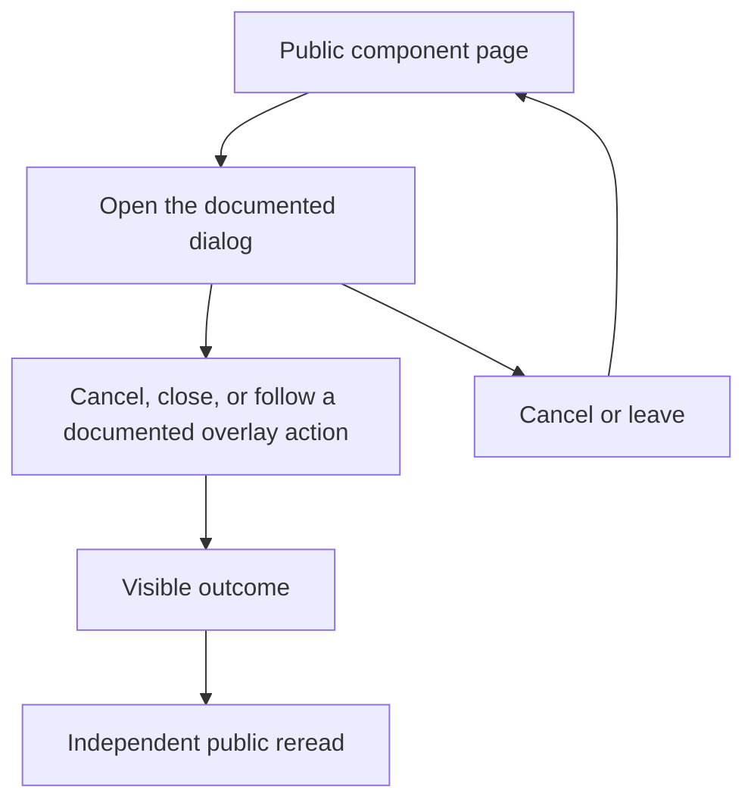

# Return from transient controls

## Actions

1. Enter the public page and identify its example and controls.
2. Cancel, close, or follow a documented overlay action.
3. Verify the result through a separate visible read, real destination or revisit.

## True end state

Overlay is absent; original control or deliberate destination owns focus and page interaction works.

## Abandonment

Cancel before taking an action, then reopen and close again; a reload restores the public entry.

## Independent reread

Read the visible destination heading and URL after link navigation; for transient
UI, inspect its absence/presence and the actual focused control, then reopen
through the original public entry. No durable server object is created.
